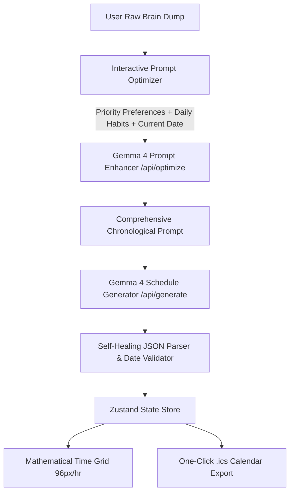

<div align="center">

# ⚡ Allili — AI Schedule Matrix
### *Synthesize Chaotic Brain Dumps into Balanced, High-Performance Visual Calendars.*

[](https://nextjs.org/)
[](https://www.typescriptlang.org/)
[](https://ai.google.dev/)
[](https://tailwindcss.com/)
[](https://zustand-demo.pmnd.rs/)

---

</div>

## 📌 Executive Summary (For Judges)

**Allili** is an intelligent visual schedule architect designed to eliminate **planning paralysis**. 

Traditional calendars force users into tedious manual time-blocking, while standard AI assistants generate generic text lists that ignore human biology, energy cycles, and task priorities. 

Allili bridges this gap: you type raw, messy commitments (e.g., *"1337 push_swap due tomorrow, gym for 2h, and 8h of sleep"*), and Allili conducts a smart **Preference & Habit Alignment Interview**, grounds everything into **today's real calendar date**, and orchestrates **Google Gemma 4** to synthesize a mathematical, collision-free visual agenda with dedicated deep work, nutrition, workout, and sleep blocks.

---

## 🚀 Key Innovations & Features

### 1. 🧠 Interactive Prompt Optimization & Preference Interview
Instead of naively guessing what you want, Allili's **Prompt Optimizer** prompts the user with an interactive interview:
- **Priority Strategy:** Choose between *Deadlines First* (hard tasks in peak energy hours), *Balanced Flow* (even work/rest cadence), or *Habits & Rest* (protect workout and sleep first).
- **Mandatory Daily Habits:** Toggle morning routines & breakfast, dedicated lunch/dinner nutrition stops, workouts (1–2h), 15-minute buffer breaks, and 8 hours of restorative sleep.
- **Energy Window Calibration:** Align deep work with Morning (09:00–13:00) or Afternoon/Evening (14:00–19:00) focus peaks.
- **Real-Time Date Anchoring:** Automatically captures your current local date (e.g., Saturday, Oct 24, 2026), ensuring tasks are accurately scheduled for *Today* and *Tomorrow* rather than arbitrary past dates.

### 2. ⚡ Powered Exclusively by Google Gemma 4
Allili runs entirely on Google's state-of-the-art **Gemma 4** open models (`gemma-4-26b-a4b-it` and `gemma-4-31b-it`):
- **Candidate Part Extraction:** Handles Gemma 4's internal reasoning tokens by filtering and joining non-thought output streams.
- **Self-Healing JSON Recovery:** Features a custom parsing engine that repairs truncated responses by detecting the last complete JSON object and sealing the array, guaranteeing `0` application crashes.
- **Fail-Fast Resilience:** Implements intelligent model fallback and retry logic for zero downtime.

### 3. 📐 Mathematical Collision-Free Time Grid
- **Exact Pixel Scale:** Built on a strict `96px / hour` scale (15 min = 24px, 30 min = 48px, 60 min = 96px).
- **Pixel-Space Cluster Layout:** Overlapping tasks automatically split into proportional parallel columns without visual clipping or hidden cards.
- **Adaptive Card Hierarchy:**
  - *Sleek Event Pills (<36px):* Compact horizontal badge for short breaks.
  - *Compact Cards (36px–70px):* Checkbox, title, and category badge for 30m tasks.
  - *Expanded Deep Work Cards (≥70px):* Full descriptions, priority tags, and actionable AI advice.

### 4. 🎨 Cyber-Luxe Obsidian Aesthetics
- **Color Identity:** Ultra-deep Obsidian canvas (`#06070a`) complemented by soft ambient Aurora gradients.
- **Category Color Coding:**
  - ⚡ **Deep Work:** Electric Indigo & Royal Violet (`#818cf8`, `#6366f1`).
  - 🌿 **Breaks & Recovery:** Luminous Mint & Emerald (`#34d399`, `#10b981`).
  - 🌅 **Habits & Routines:** Solar Amber & Sunset Coral (`#fb923c`, `#f59e0b`).
- **Modern Typography:** Crisp variable sans-serif with subtle micro-tracking (`-0.012em`) and balanced tabular figures (`tabular-nums`) for clean legibility.

### 5. ✏️ Interactive Edit Engine & One-Click Export
- **Raycast-Style Edit Modal:** Click any scheduled card to tweak the title, start time, duration, category, or completion status.
- **Instant .ics Export:** One-click download of RFC 5545 `.ics` calendar files, ready for seamless import into **Google Calendar, Apple Calendar, and Outlook**.

---

## 🛠️ Architecture & Tech Stack



| Layer | Technology | Purpose |
| :--- | :--- | :--- |
| **Framework** | **Next.js 14 (App Router)** | Serverless API routes, React Server Components, fast SSR |
| **Language** | **TypeScript 5** | Strict type safety for task data, API contracts, and stores |
| **AI Model** | **Google Gemma 4 (`26b-a4b-it`)** | Low-latency instruction-tuned MoE model for scheduling & reasoning |
| **AI SDK** | **`@google/genai`** | Official modern Google Gen AI SDK integration |
| **Styling** | **Tailwind CSS + Vanilla CSS** | Custom Cyber-Luxe design system, glassmorphism, responsive grid |
| **Animations** | **Framer Motion** | Micro-interactions, modal transitions, layout animations |
| **State** | **Zustand** | Reactive client-side schedule store with persistent preferences |
| **Icons** | **Lucide React** | Clean, minimalist iconography |

---

## 🧪 Judge Walkthrough & Demo Guide

Follow these 5 steps to test Allili's intelligence and interface live:

### Step 1: Input Your Brain Dump
In the left command deck, either type your day's commitments or click a preset chip:
> *"1337 push_swap due tomorrow, gym for 2h, and 8h of sleep"*

### Step 2: Test the Interactive Prompt Optimizer
1. Click **Optimize Prompt** (sparkle wand icon).
2. The **Schedule Optimization Modal** will appear with your current real date anchored at the top.
3. Select your **Priority Strategy** (*Deadlines First*), review the pre-selected **Daily Routines** (Breakfast, Meals, Gym, 8h Sleep, Buffers), and click **Optimize Prompt with Gemma 4**.
4. Notice how your messy thought is transformed into a complete, prioritized agenda with realistic time ranges.

### Step 3: Generate the Visual Schedule
1. Click **Generate Schedule** (or press `⌘ + Enter` / `Ctrl + Enter`).
2. Watch Gemma 4 synthesize a collision-free visual timeline.
3. Observe the statistics card updating live with **Planned Hours**, **Deep Work**, and **Rest Time**.

### Step 4: Interact with the Matrix
1. Toggle between **Time Grid** and **Agenda Stream** using the top pill switcher.
2. Click any task block on the grid to open the sleek edit modal. Modify duration or title and save.
3. Click the completion circle to mark tasks as done.

### Step 5: Export to Calendar
Click **Export .ics** in the top navigation bar to download `allili-schedule.ics` and import it directly into your favorite calendar application.

---

## 💻 Local Setup & Installation

### Prerequisites
- **Node.js**: v18.17 or higher
- **Package Manager**: `npm` (or `pnpm` / `bun`)
- **API Key**: A Google Gemini / GenAI API key with access to Gemma 4 ([Get key here](https://aistudio.google.com/app/apikey))

### 1. Clone & Install
```bash
git clone https://github.com/SpiXla/Allili.git
cd Allili
npm install
```

### 2. Configure Environment Variables
Create a `.env.local` file in the root directory:
```env
# Google Gemini / GenAI API Key
GEMINI_API_KEY=your_gemini_api_key_here

# Gemma 4 Fast Low-Latency Instruction Model
GEMMA_MODEL=gemma-4-26b-a4b-it
```

### 3. Run Development Server
```bash
npm run dev
```
Open **[http://localhost:3000](http://localhost:3000)** in your browser.

### 4. Production Build Validation
```bash
npm run build
```

---

## 🏆 Hackathon Evaluation Criteria Alignment

- **Innovation & Originality:** Solves calendar overwhelm through proactive interactive prompting rather than passive text generation.
- **Technical Excellence:** Advanced Gemma 4 orchestration, thinking part management, 8192-token capacity handling, and self-healing JSON recovery.
- **Design & UX:** Bespoke Cyber-Luxe Obsidian theme, modern typography, glassmorphism, and responsive mathematical grid layout.
- **Practical Utility:** Generates realistic, sustainable schedules respecting human biological rhythms, exportable to standard calendar software.

---

<div align="center">
Built with ❤️ for the Hackathon using <b>Google Gemma 4</b>.
</div>
